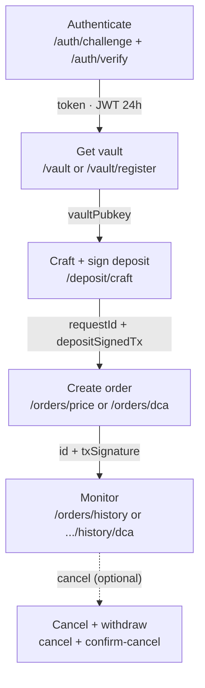
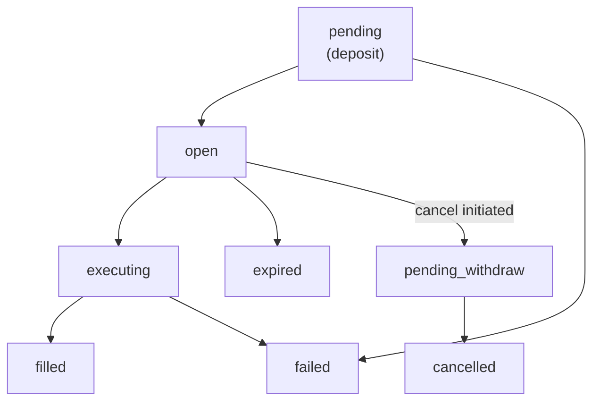
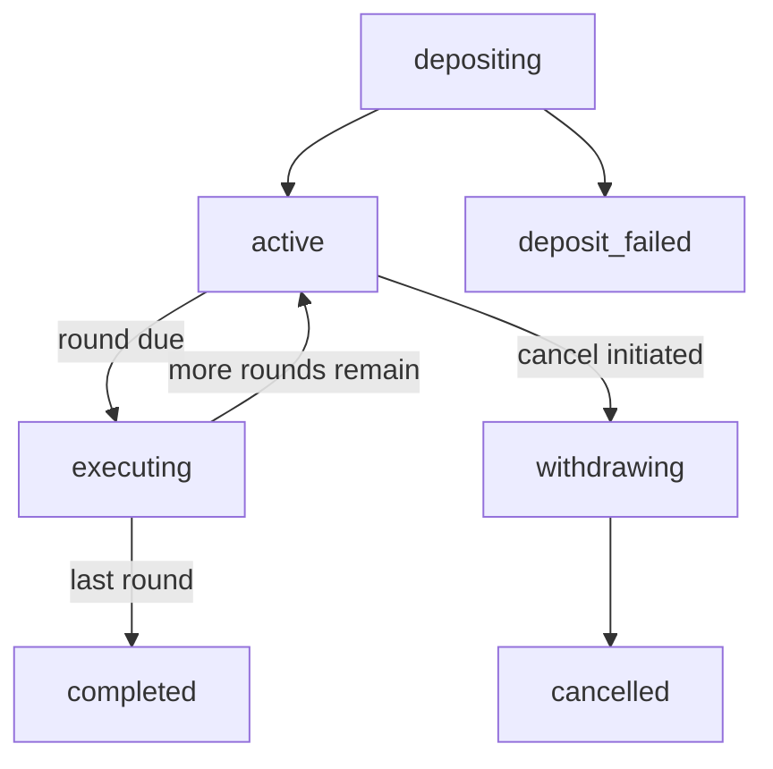

> ## Documentation Index
> Fetch the complete documentation index at: https://developers.jup.ag/docs/llms.txt
> Use this file to discover all available pages before exploring further.

# Integration Flow

> The end-to-end sequence of Trigger API calls for both limit orders and DCA, the data that flows between them, and where the two families diverge.

This page maps a trigger order from start to finish: which endpoints to call, in what order, the data that flows from one call into the next, and the states an order moves through. Both order families, price (limit) orders and DCA, follow the same spine. They differ only at the create, monitor, and manage steps. Each endpoint has its own detail page, linked at every step.

## Prerequisites

* An API key from the [Portal](https://developers.jup.ag/portal). All requests require the `x-api-key` header.
* A Solana wallet. Every step that moves funds (deposit, withdrawal) is signed client-side by the wallet owner.

## The Flow

Authenticate once, set up your vault once, then repeat deposit-and-create per order. The key to integrating is the data hand-off: each call produces the value the next call needs. The shared spine:

Create and monitor are the family-specific steps (price orders vs DCA); everything else is shared.

All endpoints are under `https://api.jup.ag/trigger/v2`.

## Limit orders vs DCA

The two families share authentication, the vault, and the deposit endpoint. They diverge at the calls below.

| Step | Limit orders | DCA |
| :- | :- | :- |
| Deposit `orderType` | `price` (with `orderSubType`) | `dca` |
| Create | `POST /orders/price` | `POST /orders/dca` |
| Order types | `single`, `oco`, `otoco` | `time_based`, `price_conditional` |
| Track | `GET /orders/history` | `GET /orders/history/dca` |
| Edit | `PATCH /orders/price/{id}` | Not supported |
| Cancel | `POST /orders/price/cancel/{id}` + `/confirm-cancel/{id}` | `POST /orders/dca/cancel/{id}` + `/confirm-cancel/{id}` |
| Detail pages | [Create](https://developers.jup.ag/docs/trigger/create-order.md), [Track](https://developers.jup.ag/docs/trigger/order-history.md), [Manage](https://developers.jup.ag/docs/trigger/manage-orders.md) | [Create](https://developers.jup.ag/docs/trigger/dca.md), [Track](https://developers.jup.ag/docs/trigger/dca-history.md), [Cancel](https://developers.jup.ag/docs/trigger/dca-cancel.md) |

## Step by Step

### 1. Authenticate

Call `POST /auth/challenge` with your `walletPubkey` and a `type` of `message` (standard wallets) or `transaction` (hardware wallets). Sign the returned challenge, then submit it to `POST /auth/verify` to receive a JWT `token`. Include the token as `Authorization: Bearer <token>` on every subsequent call.

The token is valid for 24 hours. There is no refresh endpoint: when it expires, repeat the challenge-response flow.

See [Authentication](https://developers.jup.ag/docs/trigger/authentication.md) for the message and transaction flows and the full token lifecycle.

### 2. Get or register your vault

Call `GET /vault` to resolve your vault, or `GET /vault/register` on first use. The vault is a Privy-managed custodial account that holds deposits for all your orders. The vault address is resolved from your JWT, so you do not pass it into later calls.

See [Vault & Deposit](https://developers.jup.ag/docs/trigger/deposit.md).

### 3. Craft and sign a deposit

Call `POST /deposit/craft` with the input/output mints, amount, and `orderType`. For a price order, also pass the `orderSubType` that matches the order you will create (`single`, `oco`, or `otoco`); for DCA, use `orderType: "dca"` with no subtype. It returns an unsigned `transaction` and a `requestId`. Sign the transaction client-side to produce `depositSignedTx`.

The API stores the deposit's token accounts against the `requestId`, so you carry only the `requestId` and `depositSignedTx` into the next step.

See [Vault & Deposit](https://developers.jup.ag/docs/trigger/deposit.md).

### 4. Create the order

Call your family's create endpoint with `depositRequestId`, `depositSignedTx`, and your order parameters.

* **Limit orders:** `POST /orders/price`. The `orderType` (`single`, `oco`, `otoco`) determines which fields are required. The response returns the order `id` (the `ocoId`, your primary identifier) and a `txSignature`. See [Create Order](https://developers.jup.ag/docs/trigger/create-order.md).
* **DCA:** `POST /orders/dca` with `orderCount`, `intervalSeconds`, and `orderType` (`time_based` or `price_conditional`). The response returns `{ id, txSignature }`. See [Create a DCA Order](https://developers.jup.ag/docs/trigger/dca.md).

For both families the deposit lands on-chain during this call, so a `200` means the order is live.

### 5. Monitor order state

Track an order through its lifecycle:

* **Limit orders:** `GET /orders/history`. Each order carries an `orderState` (display) and `rawState` (internal), plus an `events` array. See [Order History](https://developers.jup.ag/docs/trigger/order-history.md).
* **DCA:** `GET /orders/history/dca` (or `/orders/history/dca/{id}` for one order). Each order reports its schedule, `roundsFilled`, `fillPercent`, `state`/`displayState`, and `events`. See [Track a DCA Order](https://developers.jup.ag/docs/trigger/dca-history.md).

### 6. Edit or cancel

* **Limit orders** can be updated in place while `open`: `PATCH /orders/price/{id}` to change the trigger price, slippage, or expiry. No new deposit is needed. See [Manage Orders](https://developers.jup.ag/docs/trigger/manage-orders.md).
* **DCA orders cannot be edited.** To change a schedule, cancel and create a new order. See [Cancel a DCA Order](https://developers.jup.ag/docs/trigger/dca-cancel.md).

To cancel either family, call the family's `cancel` endpoint, which returns a withdrawal transaction to sign (step 7).

### 7. Confirm cancellation

Sign the withdrawal transaction from step 6 and submit it to the family's `confirm-cancel` endpoint (`POST /orders/price/confirm-cancel/{id}` or `POST /orders/dca/confirm-cancel/{id}`) with the `cancelRequestId`. This returns the unfilled funds to your wallet.

See [Cancellation and Recovery](#cancellation-and-recovery) for what happens if this step is interrupted.

## Order State Lifecycle

Each family has its own state machine. Both report a display state and an internal state through their history endpoint.

### Price orders

* **`open`** orders can be updated or cancelled. Updates and cancellation are only valid from this state.
* **`executing`** covers the swap from trigger detection to output withdrawal, including partial fills.
* **`expired`** orders did not fill before `expiresAt`. The deposit is still in the vault and is retrieved with the same cancel flow (see below).

**OCO orders:** the take-profit and stop-loss legs share one deposit. When one leg fills, the other transitions to `cancelled` automatically (`oco_cancelled` in the raw state). **OTOCO orders:** the child OCO pair only activates after the parent order reaches `filled`; if the parent expires or fails, the children are never created.

For the complete `orderState` ↔ `rawState` mapping and the `events` schema, see [Order History](https://developers.jup.ag/docs/trigger/order-history.md#order-states).

### DCA

DCA states map to a display state: `depositing`→`pending`, `active`, `executing`, `withdrawing`→`pending_withdraw`, `completed`, `cancelled`, and `deposit_failed`→`failed`. There is no `open` or `expired` state; a DCA ends at `completed` when its budget is spent. A `price_conditional` round that is out of band does not fill: the order stays `active` with `roundsFilled` unchanged until the price re-enters the band. For the full mapping, see [Track a DCA Order](https://developers.jup.ag/docs/trigger/dca-history.md#order-states).

## Cancellation and Recovery

Cancellation is a two-step process designed so funds are never at risk mid-flow. It works the same way for both families; the paths differ only by segment (`price` or `dca`):

1. **Initiate** with `POST /orders/{price|dca}/cancel/{id}`. The order stops accepting fills immediately, and the call returns an unsigned withdrawal transaction and a `cancelRequestId`.
2. **Confirm** by signing that transaction and submitting it to `POST /orders/{price|dca}/confirm-cancel/{id}`. The unfilled funds return to your wallet.

Between the two steps the order is safe: fills are stopped and the deposit remains in the vault.

> [!NOTE]
>
> If the second step is interrupted (the tab closes, or the transaction does not land):
>
> * **You still have the withdrawal transaction and `cancelRequestId`:** retry `confirm-cancel` with the same `cancelRequestId`.
> * **You lost the withdrawal transaction:** call `cancel` again. The order is already mid-cancel, so the call crafts and returns a fresh withdrawal transaction to sign (idempotent).
>
> The order stays mid-cancel until a withdrawal confirms on-chain, so funds are never stranded.

The details differ slightly by family. A price order can be cancelled while `open`, and the same flow retrieves funds from one that has `expired`. A DCA order can be cancelled while `active` or `withdrawing`; a failed `confirm-cancel` leaves it in `withdrawing` and does not roll back to `active`. Cancelling a DCA returns the unfilled remainder (`refundAmount`, `roundsRemaining`); rounds already filled are not reversed. See [Cancel a DCA Order](https://developers.jup.ag/docs/trigger/dca-cancel.md).

## Related

> [card] [Authentication](https://developers.jup.ag/docs/trigger/authentication.md)
>
> Challenge-response signing and the JWT token lifecycle.

> [card] [Vault & Deposit](https://developers.jup.ag/docs/trigger/deposit.md)
>
> Resolve your vault and craft the deposit both families share.

> [card] [Create Order (Limit)](https://developers.jup.ag/docs/trigger/create-order.md)
>
> Single, OCO, and OTOCO price orders.

> [card] [Create a DCA Order](https://developers.jup.ag/docs/trigger/dca.md)
>
> Time-based and price-conditional schedules.

> [card] [Best Practices](https://developers.jup.ag/docs/trigger/best-practices.md)
>
> Expiry, slippage, and integration guidance.

> [card] [API Reference](https://developers.jup.ag/docs/api-reference/trigger/challenge.md)
>
> Full endpoint specifications.

This documentation is built and hosted on [Mintlify](https://mintlify.com), a developer documentation platform.