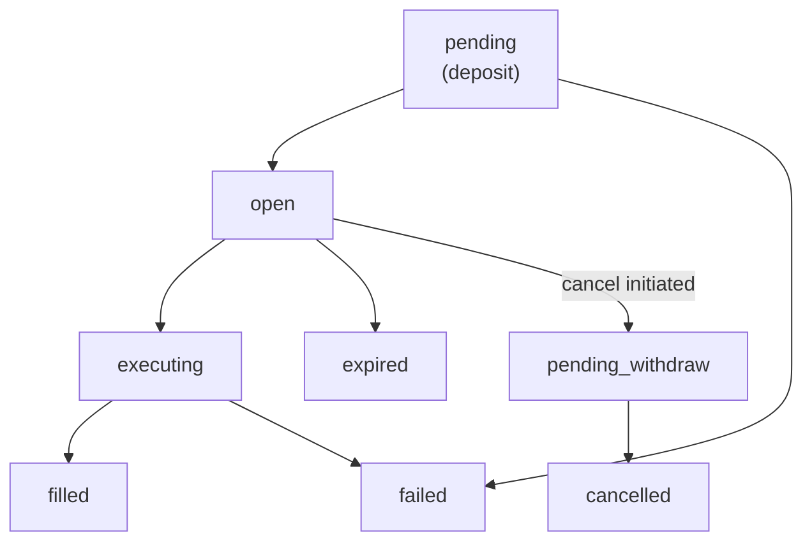

> ## Documentation Index
> Fetch the complete documentation index at: https://developers.jup.ag/docs/llms.txt
> Use this file to discover all available pages before exploring further.

# Order History (Trigger)

> Query order history, filter by state, and understand the order lifecycle.

## Get Order History

Retrieve your orders with optional filters for state, mint, and pagination.

```typescript theme={null}
const historyResponse = await fetch(
  'https://api.jup.ag/trigger/v2/orders/history?state=active&limit=20&offset=0',
  {
    headers: {
      'x-api-key': 'your-api-key',
      'Authorization': `Bearer ${token}`,
    },
  }
);

const history = await historyResponse.json();
```

### Query Parameters

| Parameter | Type | Default | Description |
| :- | :- | :- | :- |
| `state` | `string` | — | `active` (open orders) or `past` (filled/cancelled/expired) |
| `mint` | `string` | — | Filter by token mint address (input or output) |
| `limit` | `number` | `20` | Results per page (1-100) |
| `offset` | `number` | `0` | Number of results to skip |
| `sort` | `string` | `updated_at` | Sort field: `updated_at`, `created_at`, `expires_at` |
| `dir` | `string` | `desc` | Sort direction: `asc` or `desc` |

### Response

```json theme={null}
{
  "orders": [
    {
      "id": "order-uuid",
      "orderType": "single",
      "orderState": "open",
      "rawState": "open",
      "userPubkey": "YourWalletPublicKey...",
      "privyWalletPubkey": "VaultPublicKey...",
      "inputMint": "So11111111111111111111111111111111111111112",
      "initialInputAmount": "1000000000",
      "remainingInputAmount": "1000000000",
      "outputMint": "EPjFWdd5AufqSSqeM2qN1xzybapC8G4wEGGkZwyTDt1v",
      "triggerMint": "So11111111111111111111111111111111111111112",
      "triggerCondition": "above",
      "triggerPriceUsd": 200.00,
      "slippageBps": 100,
      "expiresAt": 1704067200000,
      "createdAt": 1704000000000,
      "updatedAt": 1704000000000,
      "events": [
        {
          "type": "deposit",
          "timestamp": 1704000000000,
          "txSignature": "5eykt4UsFv8P8NJdTREpY1vzqKqZKvdpKuc147dw2N9d...",
          "mint": "So11111111111111111111111111111111111111112",
          "amount": "1000000000",
          "state": "success"
        }
      ]
    }
  ],
  "pagination": {
    "total": 50,
    "limit": 20,
    "offset": 0
  }
}
```

`initialInputAmount` is the `inputAmount` you submitted on create; `remainingInputAmount` is the amount not yet filled.

### Additional Fields for Filled Orders

Orders that have been fully or partially filled include extra fields:

| Field | Description |
| :- | :- |
| `triggeredAt` | Timestamp when the price condition was met |
| `outputAmount` | Total output tokens received |
| `inputUsed` | Total input tokens consumed |
| `fillPercent` | Fill ratio (1.0 = fully filled) |

### Trailing Stop Loss Fields

Single orders created with `trailingBps` (a [trailing stop loss](https://developers.jup.ag/docs/trigger/create-order.md#trailing-stop-loss)) report these extra fields. `triggerPriceUsd` holds the current trailing trigger, which the keeper rewrites as the watermark moves.

| Field | Description |
| :- | :- |
| `trailingBps` | Trail distance in basis points. `null` for non-trailing orders. |
| `highWatermark` | Highest observed trigger-mint price (sell-below trailing). `null` otherwise. |
| `lowWatermark` | Lowest observed trigger-mint price (buy-above trailing). `null` otherwise. |

### Execution Attempts

Order history includes execution attempts for each order. When an order fails to execute (due to slippage, quote generation failure, or other reasons), the attempt is recorded in the history. The reason for failure is not included in the response.

Users can adjust slippage settings via the [update endpoint](https://developers.jup.ag/docs/trigger/manage-orders.md) if execution keeps failing due to slippage.

### Event Types

Each order includes an `events` array tracking its lifecycle:

| Event Type | Description |
| :- | :- |
| `deposit` | Tokens deposited into vault |
| `fill` | Order executed (full or partial) |
| `withdrawal` | Tokens withdrawn back to wallet |
| `cancelled` | Order cancelled by user |
| `expired` | Order expired |

Each event includes `type`, `timestamp`, and `state`. Events that involve token movement (`deposit`, `fill`, `withdrawal`) also include:

| Field | Description |
| :- | :- |
| `txSignature` | On-chain transaction signature |
| `mint` | Token mint address |
| `amount` | Token amount (in smallest unit) |

Fill events include additional fields:

| Field | Description |
| :- | :- |
| `outputMint` | Output token mint address |
| `outputAmount` | Output amount received |
| `orderContext` | Semantic order type: `take_profit`, `stop_loss`, `buy_above`, or `buy_below` |

## Order States

Orders follow a state machine from creation to completion. The `orderState` field provides a human-friendly state, while `rawState` shows the exact internal state. For a high-level view of how an order moves through these states, including OCO and OTOCO branching, see the [Integration Flow](https://developers.jup.ag/docs/trigger/lifecycle.md#order-state-lifecycle) page.

### Display States

| State | Description |
| :- | :- |
| `pending` | Deposit is being processed |
| `open` | Active and waiting for price trigger |
| `executing` | Price condition met, swap in progress |
| `filled` | Order completed successfully |
| `pending_withdraw` | Cancellation initiated, awaiting signed withdrawal |
| `cancelled` | User cancelled the order |
| `expired` | Order expired before execution |
| `failed` | Execution failed |

### Raw States

The `rawState` field exposes the internal processing state. Multiple raw states map to each display state:

| `orderState` | `rawState` | Meaning |
| :- | :- | :- |
| `pending` | `pending_deposit` | Deposit transaction not yet submitted |
| `pending` | `depositing` | Deposit transaction submitted, awaiting confirmation |
| `open` | `open` | Active and monitoring price |
| `executing` | `ready_execute` | Price condition met, preparing swap |
| `executing` | `ready_expire` | Order expiry detected, processing |
| `executing` | `executing` | Swap transaction in flight |
| `executing` | `execute_success` | Swap landed, validating output |
| `executing` | `execute_failed` | Swap attempt failed, may retry |
| `executing` | `ready_withdraw_output` | Output ready to withdraw to wallet |
| `executing` | `withdrawing` | Withdrawal transaction in flight |
| `filled` | `fill_success` | Order fully filled and output withdrawn |
| `executing` | `partial_fill_success` | Order partially filled, may continue filling |
| `pending_withdraw` | `ready_to_cancel` | Cancellation initiated, awaiting signed withdrawal |
| `cancelled` | `cancelled` | User cancelled the order |
| `cancelled` | `oco_cancelled` | Automatically cancelled because the other side of an OCO pair filled |
| `expired` | `expired` | Order expired before execution |
| `failed` | `deposit_failed` | Deposit transaction failed on-chain (e.g. insufficient balance) |
| `failed` | `withdraw_failed` | Output withdrawal failed after execution |
| `failed` | `fill_failed` | Fill validation failed after execution |

### State Flow



For OCO orders, when one side fills, the other transitions to `cancelled` automatically (displayed as `oco_cancelled` in the raw state).

For OTOCO orders, the child OCO pair only activates after the parent order reaches `filled`. If the parent expires or fails, the children are never created.


This documentation is built and hosted on [Mintlify](https://mintlify.com), a developer documentation platform.